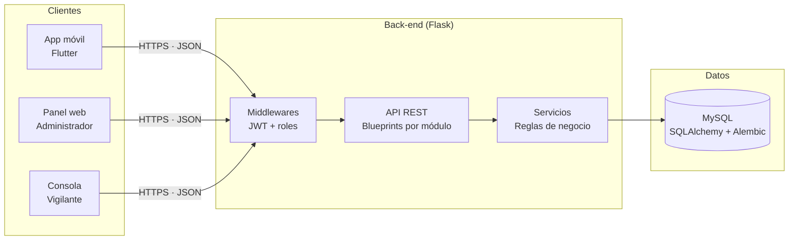
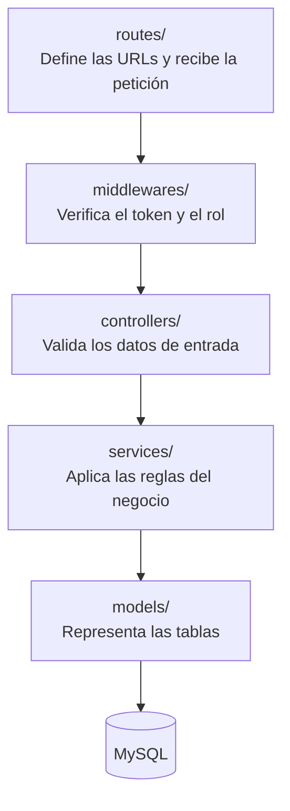
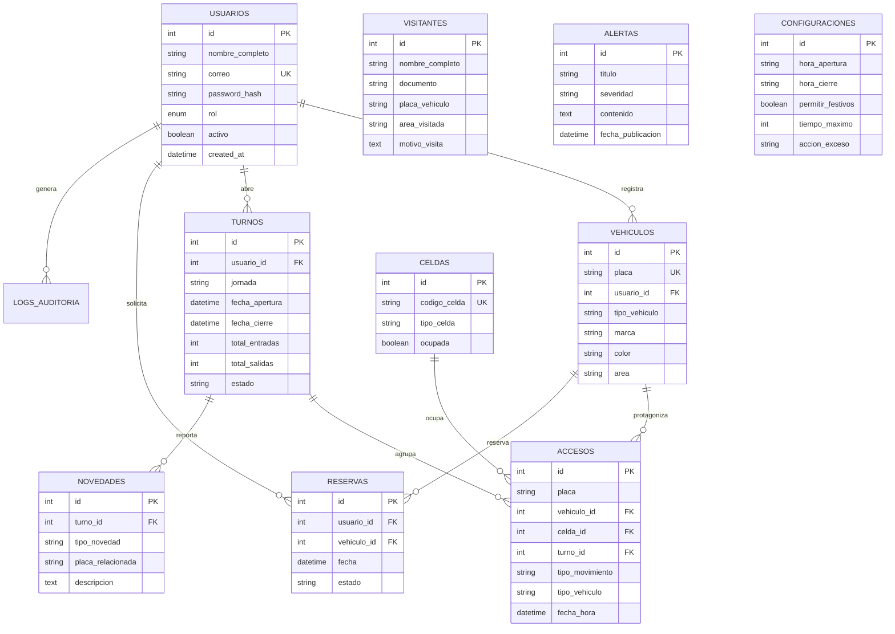
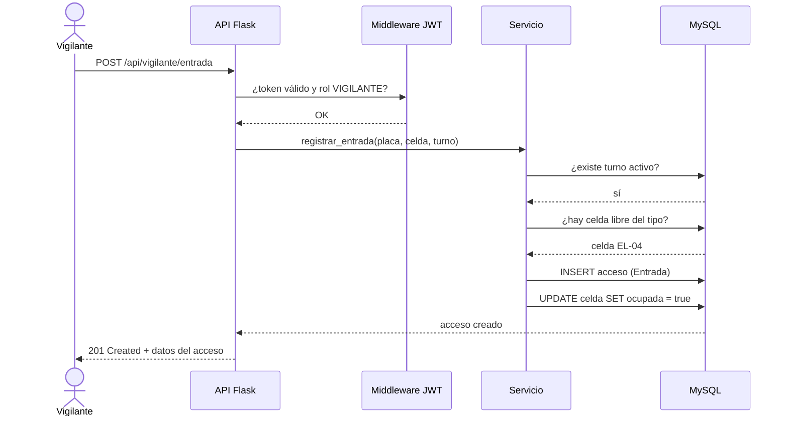
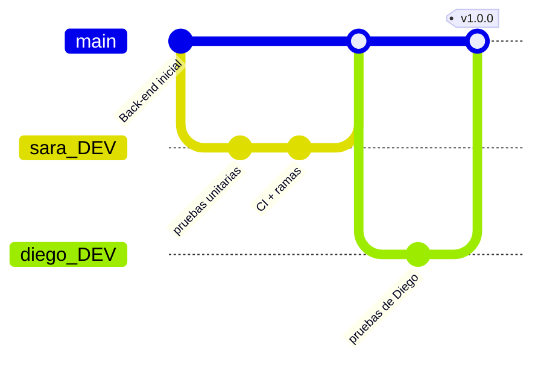
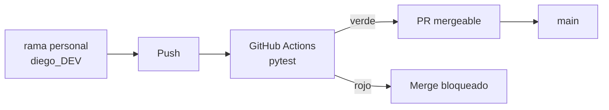

# Arquitectura — ParkLink Back-End

Este documento explica cómo está construido el sistema y cómo se comunican sus
partes. Está pensado para que alguien que llega nuevo entienda el proyecto sin
leer el código.

---

## 1. Visión general

ParkLink es un sistema de gestión de parqueaderos con tres clientes y un solo
back-end:



**Puntos clave**

| Aspecto | Decisión |
|---|---|
| Autenticación | JWT en el header `Authorization: Bearer <token>` |
| Autorización | Rol del usuario (`ADMIN`, `VIGILANTE`, `USUARIO`) validado en el middleware |
| Persistencia | MySQL vía SQLAlchemy; migraciones versionadas con Alembic |
| Tiempo real | Flask-SocketIO para notificaciones y cambios de estado |
| Pruebas | pytest, separadas por integrante en `tests/<persona>/` |
| CI | GitHub Actions ejecuta `pytest` en cada push y bloquea el merge a `main` |

---

## 2. Capas del back-end



| Carpeta | Responsabilidad | Ejemplo |
|---|---|---|
| `app/routes/` | Un blueprint por módulo; no contiene lógica | `celdas.py` |
| `app/middlewares/` | `roles.py` decide quién puede entrar | `requiere_rol("ADMIN")` |
| `app/controllers/` | Traduce la petición a llamadas del servicio | `auth_controller.py` |
| `app/services/` | Reglas de negocio reutilizables | `vehiculo_service.py` |
| `app/models/` | Entidades y relaciones | `usuario.py` |
| `app/config/` | Variables por entorno | `settings.py` |

---

## 3. Modelo de datos



### Reglas de integridad

| Relación | Comportamiento al borrar |
|---|---|
| `accesos.vehiculo_id` | `SET NULL` — el histórico del acceso se conserva |
| `accesos.turno_id` | `RESTRICT` — no se puede borrar un turno con movimientos |
| `novedades.turno_id` | `CASCADE` — la novedad vive mientras viva el turno |
| `vehiculos → accesos` | `cascade="all, delete-orphan"` en el ORM |

---

## 4. Flujo de una entrada de vehículo



---

## 5. Flujo de trabajo con Git



Cada integrante trabaja en su rama `*_DEV` y solo puede llegar a `main` mediante
un Pull Request que pase el check **`pytest`**.



---

## 6. Estructura de carpetas

```
parklink-backend/
├── app/
│   ├── __init__.py          Fábrica de la aplicación y registro de blueprints
│   ├── config/              Configuración por entorno
│   ├── controllers/         Lógica de los endpoints
│   ├── database/            Conexión e inicialización
│   ├── middlewares/         Validación de JWT y roles
│   ├── models/              Entidades del dominio
│   ├── routes/              Un blueprint por módulo
│   └── services/            Reglas de negocio
├── docs/                    Esta documentación
├── migrations/              Historial de Alembic
├── tests/
│   ├── conftest.py          Fixtures compartidos
│   └── <persona>/unit/      Pruebas por integrante
├── .github/workflows/       Integración continua
├── pytest.ini               Configuración de pytest
├── run.py                   Punto de entrada
└── seed.py                  Datos de prueba
```
